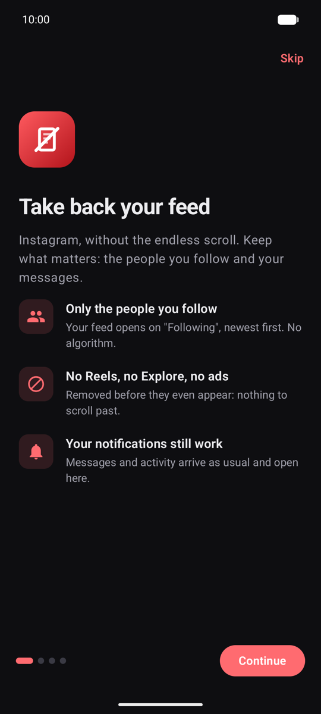
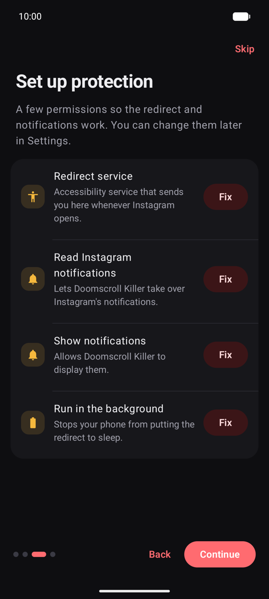
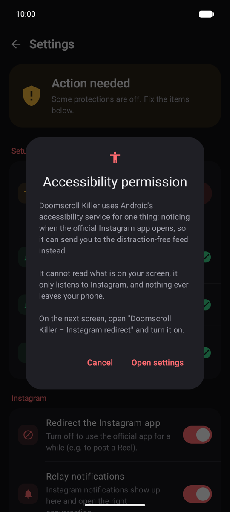
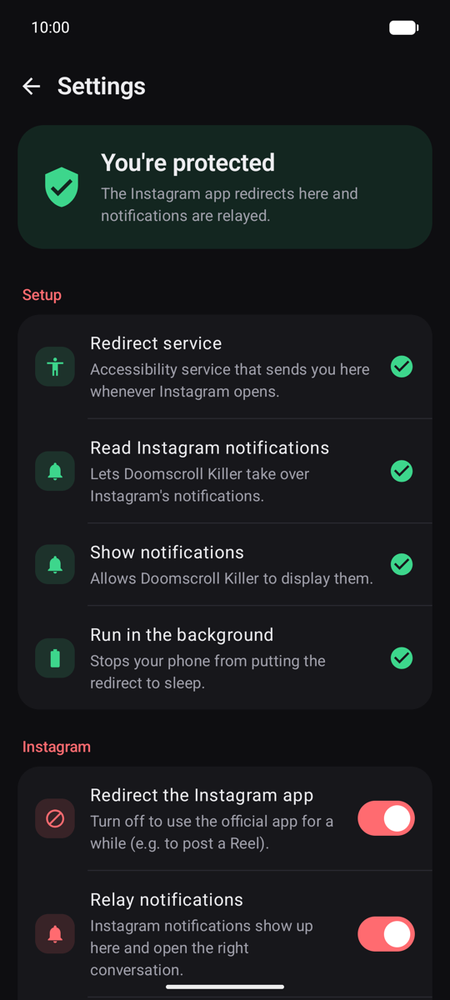
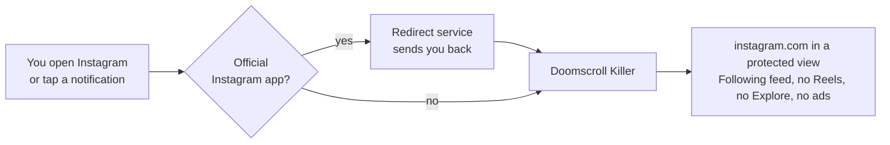

<div align="center">


# Doomscroll Killer

**Instagram, without the doomscroll.**<br/>
Keep the people you follow and your messages. Lose Reels, Explore, ads and the algorithm.

[](https://github.com/NTG-FR/Doomscroll-Killer-Instagram-APK/actions/workflows/ci.yml)
[](https://github.com/NTG-FR/Doomscroll-Killer-Instagram-APK/releases/latest)
[](#requirements)
[](LICENSE)

[**Download the APK**](https://github.com/NTG-FR/Doomscroll-Killer-Instagram-APK/releases/latest) · [How it works](#how-it-works) · [Privacy](#privacy) · [FAQ](#faq)

</div>

---

<div align="center">
<table>
  <tr>
    <td></td>
    <td></td>
    <td></td>
    <td></td>
  </tr>
  <tr>
    <td align="center"><sub>Welcome</sub></td>
    <td align="center"><sub>Guided setup</sub></td>
    <td align="center"><sub>Clear permissions</sub></td>
    <td align="center"><sub>Protection status</sub></td>
  </tr>
</table>
</div>

## Why

Instagram is built to keep you scrolling: Reels autoplay one after the other, Explore never ends, and the home feed is mostly posts from people you don't follow. Blockers that hide things on top of the app tend to lag and flicker.

Doomscroll Killer takes a different approach: **it never shows you the endless parts in the first place.**

## Features

| | |
|---|---|
| 👥 **Following only** | The feed opens on Instagram's chronological *Following* feed. The algorithmic *For you* home is skipped automatically. |
| 🚫 **No Reels, no Explore** | The Reels tab, Reels in the feed and the Explore grid are removed before they are drawn. Search still works. |
| 💬 **Messages work** | DMs, stories, profiles and posting photos work as usual. A Reel a friend sends you plays, but you can't scroll to the next one. |
| 🔔 **Notifications work** | Instagram notifications keep arriving and open the right conversation in Doomscroll Killer. |
| 🛡️ **No way around it** | If the official Instagram app opens (icon, link, habit), you're sent back to Doomscroll Killer. |
| 🔒 **Private** | No account, no server, no analytics. Open source. |

## How it works



1. **The feed** is instagram.com, shown inside the app. Filtering rules ([`InstagramWebRules.kt`](app/src/main/java/io/github/ntgfr/doomscrollkiller/web/InstagramWebRules.kt)) hide Reels, Explore, ads and suggestions with CSS and a small script. The browser removes them *before* drawing: no flicker.
2. **The official Instagram app** stays installed, ideally with its icon hidden, only to receive push notifications. An accessibility service notices when it comes to the foreground and sends you back to Doomscroll Killer. It cannot read your screen.
3. **Notifications** from the official app are re-posted as Doomscroll Killer notifications and the originals removed, so tapping one opens the built-in feed at the right page.

## Requirements

- Android **8.0 (API 26)** or newer, any brand. iOS is not supported.
- An Instagram account.
- The official Instagram app, only if you want notifications.

## Install

1. Download the latest **`DoomscrollKiller-x.y.z.apk`** from [Releases](https://github.com/NTG-FR/Doomscroll-Killer-Instagram-APK/releases/latest) and open it. Allow your browser to install apps if asked.
2. Open **Doomscroll Killer** and follow the setup. It walks you through each permission and shows a ✅ when it's done:
   - **Redirect the Instagram app**: Accessibility → *Doomscroll Killer – Instagram redirect* → On.
     <br/>On **Android 13+**, if the switch is greyed out ("Restricted setting"): *App info* → **⋮** → **Allow restricted settings**, then try again. Android does this for every app installed from a file.
   - **Read Instagram notifications** and **Show notifications**.
   - **Run in the background** (battery optimisation off).
3. Log in to Instagram once inside the app.
4. Hide the official Instagram app's icon (don't uninstall it if you want notifications). The app shows how to do this on your phone brand.

> **Xiaomi, Samsung, Huawei, OnePlus, Oppo, Vivo…** These phones stop background apps aggressively. The app shows the extra steps for your brand, and [dontkillmyapp.com](https://dontkillmyapp.com) has detailed guides.

## Privacy

Doomscroll Killer has **no server and no analytics**. Your Instagram login stays in the app's private storage on your phone and is excluded from backups.

| Permission | Why |
|---|---|
| Internet | Load instagram.com in the built-in feed. The app itself sends nothing anywhere. |
| Accessibility service | Know **when** the official Instagram app opens, to redirect you. Restricted to Instagram, and configured so it **cannot read screen content** (`canRetrieveWindowContent="false"`). |
| Notification access | Take over notifications posted by the official Instagram app. Other apps' notifications are ignored. |
| Show notifications | Display the relayed notifications. |
| Ignore battery optimisation | Keep the redirect and the relay alive in the background. |

The code is open source under GPL-3.0: anyone can check that it does what this page says.

## FAQ

<details>
<summary><b>Is this allowed by Instagram? Can my account get banned?</b></summary>

Doomscroll Killer shows the regular instagram.com website, the same one you'd open in a browser, and only hides parts of it on your screen. It makes no automated requests and does not scrape anything. That said, it is not affiliated with or endorsed by Instagram or Meta: use it at your own discretion.
</details>

<details>
<summary><b>Why keep the official app installed?</b></summary>

Only the official app can receive Instagram's push notifications. A web page shown inside an app can't. If you don't care about notifications, you can uninstall it: the built-in feed works on its own.
</details>

<details>
<summary><b>I need the official app for a moment (e.g. to post a Reel).</b></summary>

Settings → turn off **Redirect the Instagram app**, then turn it back on.
</details>

<details>
<summary><b>Something isn't hidden anymore / the feed looks broken.</b></summary>

Instagram changes its website regularly. Please [open an issue](https://github.com/NTG-FR/Doomscroll-Killer-Instagram-APK/issues/new/choose) with the "Filter broken" template. Fixes usually take a single line in one file: see [Updating the rules](docs/UPDATING_RULES.md).
</details>

<details>
<summary><b>Does it work if my Instagram is not in English?</b></summary>

Most rules rely on page structure and link addresses, which are the same in every language. A few labels (e.g. "Sponsored") are translated: English and French are covered today, and adding a language is a one-line pull request.
</details>

<details>
<summary><b>The redirect stopped working.</b></summary>

Your phone probably stopped the service (common after swiping the app away from Recents, or after an update). The shield at the top of the feed turns orange: tap it and follow the steps.
</details>

## Build from source

Requirements: Android Studio (or JDK 17+ and the Android SDK).

```bash
git clone https://github.com/NTG-FR/Doomscroll-Killer-Instagram-APK.git
cd Doomscroll-Killer-Instagram-APK
./gradlew assembleDebug        # app/build/outputs/apk/debug/app-debug.apk
./gradlew test lintDebug       # unit tests and lint
```

Install on a phone with USB debugging enabled:

```bash
adb install -r app/build/outputs/apk/debug/app-debug.apk
```

Release builds are signed when `keystore.properties` exists at the project root (see [CONTRIBUTING.md](CONTRIBUTING.md#release-signing)).

## Project structure

| Path | What it does |
|---|---|
| [`web/InstagramWebRules.kt`](app/src/main/java/io/github/ntgfr/doomscrollkiller/web/InstagramWebRules.kt) | **The filtering rules**: blocked addresses, CSS, labels. The file to edit when Instagram changes. |
| [`web/InstagramWebController.kt`](app/src/main/java/io/github/ntgfr/doomscrollkiller/web/InstagramWebController.kt) | The WebView: navigation guard, uploads, full-screen video, session. |
| [`service/InstagramRedirectService.kt`](app/src/main/java/io/github/ntgfr/doomscrollkiller/service/InstagramRedirectService.kt) | Accessibility service redirecting the official app. |
| [`notifications/`](app/src/main/java/io/github/ntgfr/doomscrollkiller/notifications) | Notification relay and routing. |
| [`system/`](app/src/main/java/io/github/ntgfr/doomscrollkiller/system) | Permission checks, settings shortcuts, per-brand tips. |
| [`ui/`](app/src/main/java/io/github/ntgfr/doomscrollkiller/ui) | Jetpack Compose screens: onboarding, feed, settings, developer captures. |

## Contributing

Contributions are welcome, especially rule updates when Instagram changes and support for more languages. Read [CONTRIBUTING.md](CONTRIBUTING.md) and [docs/UPDATING_RULES.md](docs/UPDATING_RULES.md).

## License

[GPL-3.0](LICENSE). You may use, study, share and modify this app; modified versions you distribute must stay open source under the same license.

Icons from [Material Symbols](https://fonts.google.com/icons) (Apache-2.0).

---

<sub>Doomscroll Killer is an independent project, not affiliated with, endorsed or sponsored by Instagram or Meta Platforms, Inc. Instagram is a trademark of Meta Platforms, Inc.</sub>
